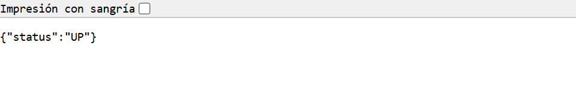
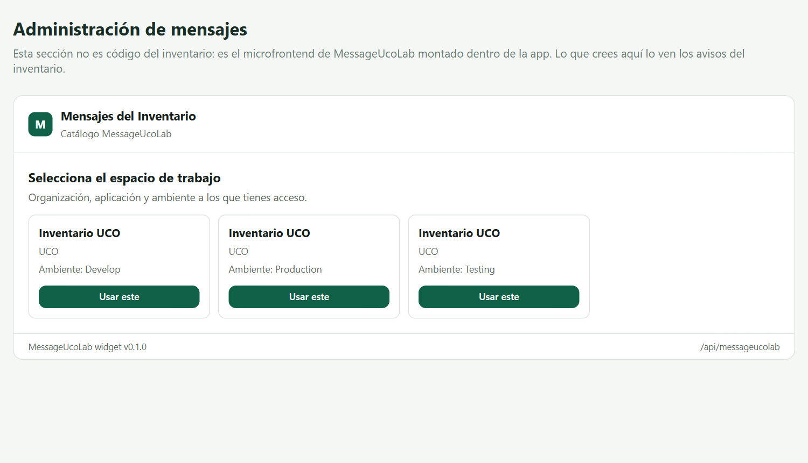
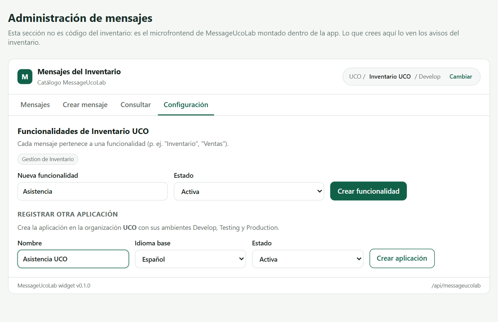
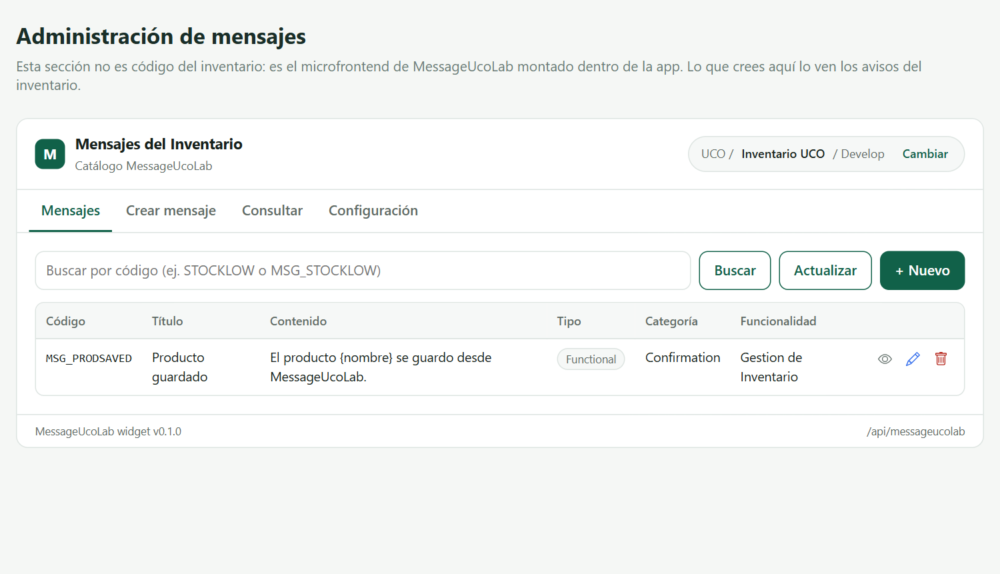
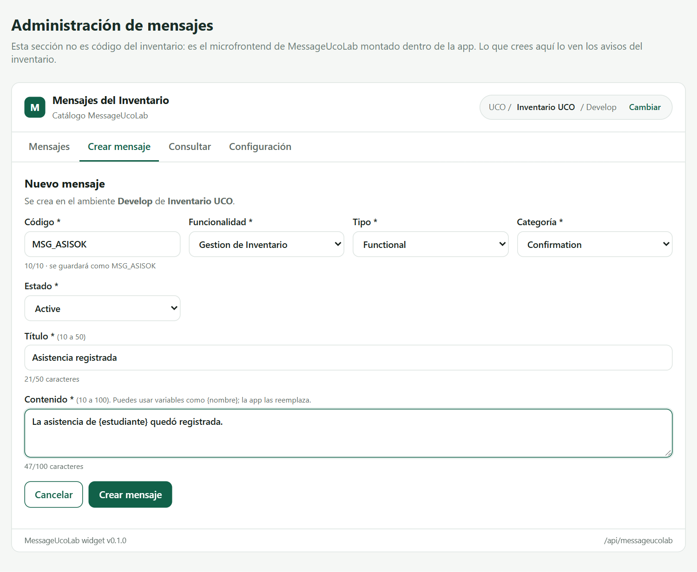
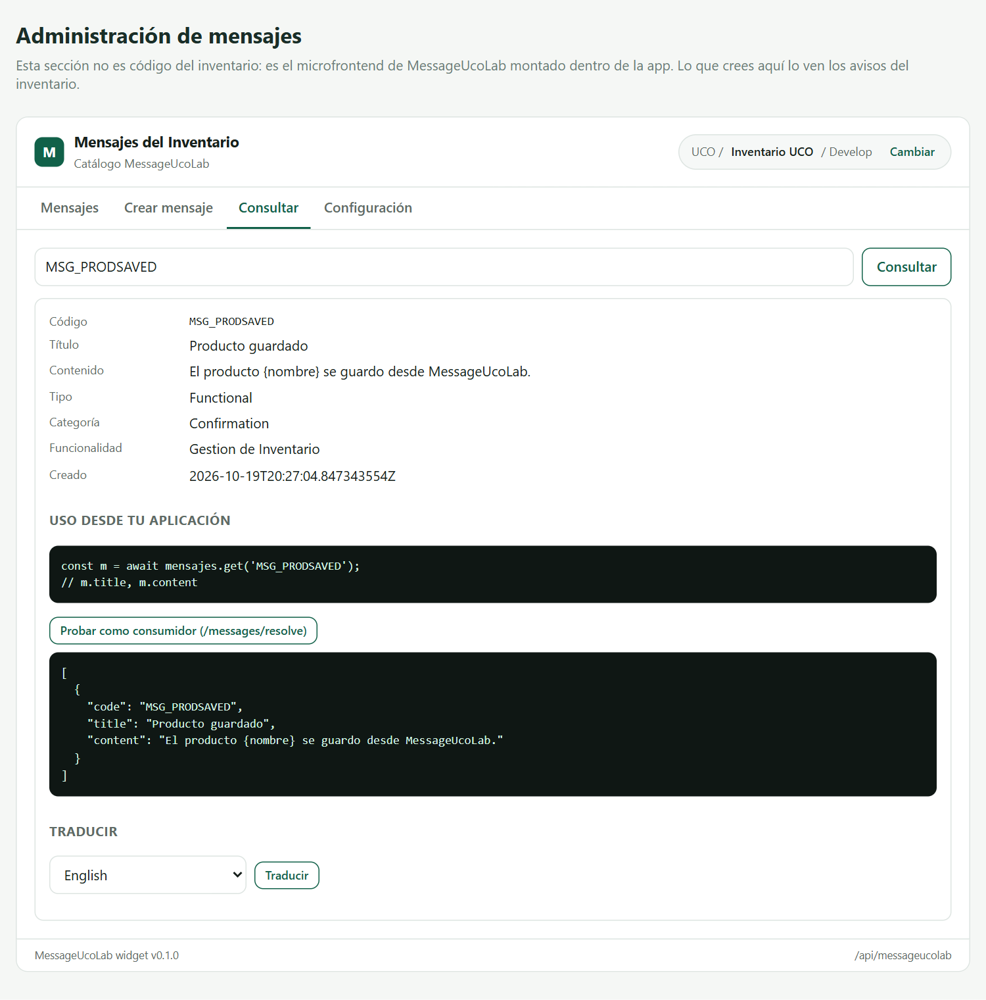
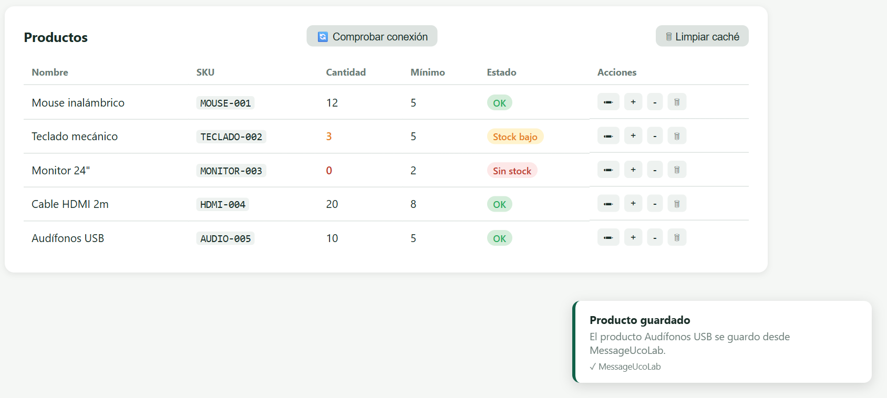

# Guía de integración: consumir el componente de mensajes (MessageUcoLab)

Esta guía es para los equipos del semillero que van a **usar** el componente de mensajes desde su
aplicación (Asistencia, Parámetros, Seguridad u otra). Síganla en orden: cada paso dice qué hacer,
cómo comprobar que quedó bien y qué hacer si algo falla.

> Los valores entre `<...>` se reemplazan: `<VERSION>` es la versión publicada de MessageUcoLab y
> `<ORGANIZACION_GITHUB>` es la organización de GitHub del equipo de mensajes. Ambos los entrega el
> equipo de mensajes.

> Las capturas de esta guía usan **Inventario UCO**, una aplicación de ejemplo que ya consume
> MessageUcoLab. En tu caso verás el nombre de tu aplicación en lugar de "Inventario UCO".

---

## 1. Qué es MessageUcoLab y qué vas a lograr

Hoy tu aplicación tiene textos escritos directamente en el código:

```java
return "Los cambios se guardaron correctamente.";
```

MessageUcoLab guarda esos textos en un solo lugar, y tu aplicación los pide por un **código**:

```java
return mensajes.get("MSG_PRODSAVED");
```

Así puedes corregir, cambiar o traducir un texto **sin volver a desplegar tu aplicación**.

### Cómo encajan las piezas

```
                 ┌───────────────────────────────┐
  Tu front ─────▶│  Pantalla de administración   │  (minifront-mensajes, montado en tu front)
  (personas)     │  crear y editar mensajes      │──┐
                 └───────────────────────────────┘  │
                                                    ▼
  Tu backend ──── encabezado Token ──────────▶  MessageUcoLab (API)  ──▶  SurrealDB / Redis
  (sin personas)  "dame MSG_PRODSAVED"           corre en tu máquina con Docker
```

- **Las personas** administran los mensajes desde una pantalla que montas dentro de tu front
  (pasos 3 y 4). No necesitan escribir comandos.
- **Tu backend** pide los mensajes de servidor a servidor con un **token de integración** (pasos 5
  y 6). El navegador de tus usuarios nunca llama a MessageUcoLab directamente.

### Lo que vas a hacer

| Paso | Qué haces | Tiempo aproximado |
|---|---|---|
| 2 | Levantar MessageUcoLab en tu máquina | 15 min (la primera vez descarga imágenes) |
| 3 | Montar la pantalla de administración en tu front | 15 min |
| 4 | Registrar tu aplicación y crear tus mensajes desde esa pantalla | 10 min |
| 5 | Obtener tu token de integración | 5 min |
| 6 | Consumir los mensajes desde tu backend | 20 min |
| 7 | Verificar que todo funciona, incluso si MessageUcoLab falla | 10 min |

---

## 2. Levantar MessageUcoLab en tu máquina

> **Por ahora no existe un ambiente compartido**, así que cada equipo levanta MessageUcoLab en su
> propia máquina. No necesitas clonar el repositorio del backend ni compilar nada: descargas un
> archivo y ejecutas imágenes ya publicadas. Cuando exista un ambiente compartido, este paso
> desaparece y solo necesitarás su URL.

### 2.1 Requisitos

- **Docker Desktop** en ejecución, con Docker Compose v2.
- **Doppler CLI** instalado: <https://docs.doppler.com/docs/install-cli>.
- **Una cuenta gratuita de Doppler** (es tuya; el equipo de mensajes no te entrega secretos).
- **Node.js 18 o superior**, para la pantalla de administración del paso 3.
- Puertos libres: `8085` (API), `5176` (pantalla de administración), `8005` (SurrealDB), `6379`
  (Redis), `8080` y `6800` (Pulsar) y, si usas traducción, `11434` (Ollama).

### 2.2 Descargar el archivo de despliegue

1. Crea una carpeta **fuera** del repositorio de tu aplicación, por ejemplo `messageucolab-local`.
2. Abre en el navegador la página de releases del componente:
   <https://github.com/CamiloGarcia09/NosGraduamos-FC/releases>.
3. En la versión `v<VERSION>`, descarga el archivo `compose.yaml` y guárdalo en esa carpeta.

Este archivo no contiene contraseñas.

### 2.3 Crear tus secretos en Doppler (manual)

En el semillero **las contraseñas nunca se escriben en archivos**: viven en Doppler. Como la base de
datos y Redis corren en tu máquina, **tú inventas las contraseñas**; no tienen que coincidir con
las de ningún otro equipo.

1. En <https://dashboard.doppler.com> crea un proyecto llamado `messageucolab-local`. Doppler crea
   automáticamente la configuración `dev`.
2. Entra a la configuración `dev` y agrega **estos 4 secretos** con **Add Secret**:

| Secreto | Qué poner | Ejemplo de formato |
|---|---|---|
| `SURREALDBUSER` | Un nombre de usuario para la base de datos | `admin` |
| `SURREALDBPASSWORD` | Una contraseña que inventes, de 16 caracteres o más | (no la compartas) |
| `REDISPASSWORD` | Otra contraseña que inventes, de 16 caracteres o más | (no la compartas) |
| `SIMULATED_SECURITY_TOKEN` | Un texto largo que inventes. Es la "llave" para administrar mensajes mientras se integra el componente de seguridad | (no la compartas) |

3. Guarda los cambios (**Save**).
4. En una terminal, dentro de la carpeta `messageucolab-local`, inicia sesión y vincula la carpeta
   con el proyecto:
   ```bash
   doppler login
   doppler setup --project messageucolab-local --config dev
   ```

> Todo lo demás (puertos, nombres de la base de datos, configuración de traducción) ya viene con
> valores por defecto en el `compose.yaml`. No agregues más secretos salvo que esta guía lo indique.

### 2.4 Levantar los servicios

En la misma terminal:

```bash
doppler run -- docker compose up -d
```

La primera vez tarda varios minutos porque descarga las imágenes. Doppler inyecta los secretos en
memoria al arrancar; nunca quedan escritos en un archivo. En **Docker Desktop → Containers** verás
los servicios del proyecto en estado *Running*.

Si además vas a usar la **traducción con IA** (opcional), levanta también el perfil `traduccion`.
Descarga un modelo de unos 2 GB la primera vez:

```bash
doppler run -- docker compose --profile traduccion up -d
```

### 2.5 Comprobar que quedó arriba

Abre en el navegador <http://localhost:8085/actuator/health>. Debes ver `{"status":"UP"}`:



| Si ves… | Qué hacer |
|---|---|
| "No se puede acceder a este sitio" | Espera un minuto más; la API arranca después de la base de datos |
| Un servicio en *Exited* en Docker Desktop | Abre sus registros (*Logs*) y revisa que los 4 secretos existan en Doppler |
| `port is already allocated` al levantar | Otro programa usa ese puerto; ciérralo o cambia el puerto en `compose.yaml` |

> **Cuidado:** `docker compose down -v` **borra todos los datos** (aplicaciones, mensajes y
> tokens). Para apagar sin perder nada usa `docker compose down`, sin `-v`.

---

## 3. Montar la pantalla de administración en tu front

La pantalla de administración es un **microfrontend** llamado `minifront-mensajes`. Lo montas dentro
de tu front y desde ahí tu equipo registra la aplicación y crea, edita, consulta y traduce mensajes.
Funciona igual en Vue, React, Angular o HTML, y sus estilos no se mezclan con los tuyos.

### 3.1 Obtener y levantar la pantalla

Clona el repositorio **fuera** de tu proyecto y levántalo:

```bash
git clone https://github.com/<ORGANIZACION_GITHUB>/minifront-mensajes.git
cd minifront-mensajes
npm install
npm run serve
```

`npm install` se ejecuta una sola vez. Deja esa terminal abierta mientras uses la pantalla. Para
comprobar que responde, abre <http://localhost:5176/messageucolab.js> en el navegador: debe mostrar
código JavaScript.

### 3.2 Reenviar las llamadas a la API (evita problemas de CORS)

La API de MessageUcoLab no publica encabezados CORS. En desarrollo, haz que el servidor de tu front
reenvíe `/messageucolab` a la API, para que el navegador lo vea como el mismo origen.

**Vite** (`vite.config.js`):

```js
server: {
  proxy: { '/messageucolab': { target: 'http://localhost:8085', changeOrigin: true } }
}
```

**Angular** (`proxy.conf.json`, y `ng serve --proxy-config proxy.conf.json`):

```json
{ "/messageucolab": { "target": "http://localhost:8085", "secure": false, "changeOrigin": true } }
```

### 3.3 Montar la pantalla

Crea una ruta (por ejemplo `/mensajes`) con un contenedor vacío y monta la pantalla:

```js
const remote = await import(/* @vite-ignore */ 'http://localhost:5176/messageucolab.js');

const widget = remote.mount(document.querySelector('#mensajes'), {
  apiBaseUrl: '/messageucolab',
  getToken: () => import.meta.env.VITE_MESSAGEUCOLAB_ADMIN_TOKEN,
  title: 'Mensajes de Asistencia',
  theme: { accent: '#116149', radius: '12px' }
});

// al salir de la pantalla
widget.unmount();
```

`VITE_MESSAGEUCOLAB_ADMIN_TOKEN` es el mismo `SIMULATED_SECURITY_TOKEN` del paso 2.3. Para no
escribirlo en un archivo, inyéctalo desde Doppler al arrancar tu front:

```bash
doppler run --project messageucolab-local --config dev -- \
  bash -c 'VITE_MESSAGEUCOLAB_ADMIN_TOKEN=$SIMULATED_SECURITY_TOKEN npm run dev'
```

Abre la ruta `/mensajes` de tu front. Si todo quedó bien, la pantalla te pide escoger un espacio de
trabajo (organización, aplicación y ambiente):



| Si ves… | Qué hacer |
|---|---|
| "No se pudo cargar el microfrontend" | La terminal de `npm run serve` (paso 3.1) está cerrada |
| La pantalla carga pero dice que no hay contextos | La llave de administración no coincide con `SIMULATED_SECURITY_TOKEN`: revisa cómo arrancaste tu front |
| Error de red o CORS en la consola del navegador | Falta el reenvío del paso 3.2 o no reiniciaste tu front después de agregarlo |

> **Temporal:** esta llave de administración existe solo mientras se integra el componente de
> seguridad. Cuando esté integrado, las personas iniciarán sesión con su cuenta del semillero y esta
> opción desaparecerá.

---

## 4. Registrar tu aplicación y crear tus mensajes

Todo este paso se hace **desde la pantalla** que montaste en el paso 3. Se hace **una sola vez** por
aplicación.

### 4.1 Conceptos que necesitas

```
Organización (UCO)
 └─ Aplicación           tu sistema, por ejemplo "Asistencia UCO"
     ├─ Ambientes        Develop, Testing y Production: se crean solos con la aplicación
     ├─ Funcionalidades  agrupan mensajes por tema, por ejemplo "Asistencia"
     └─ Mensajes         código + título + contenido + tipo + categoría + estado
```

- El **código** siempre empieza por `MSG_`. Escribes solo el sufijo (`ASISOK`) y queda
  `MSG_ASISOK`. Máximo 10 caracteres: letras, números y espacios.
- El código es **único dentro de tu aplicación**.
- Un mensaje se crea en **un ambiente**: el que tengas seleccionado arriba a la derecha.
- Solo se entregan mensajes en estado **Active**.

### 4.2 Registrar tu aplicación

1. En la pantalla de selección, pulsa **Usar este** en cualquier espacio de trabajo de la
   organización UCO.
2. Abre la pestaña **Configuración** y baja hasta **Registrar otra aplicación**.
3. Escribe el nombre de tu aplicación, elige el idioma base y el estado **Activa**, y pulsa
   **Crear aplicación**.



MessageUcoLab crea la aplicación con sus tres ambientes: Develop, Testing y Production.

### 4.3 Seleccionar tu aplicación y su ambiente

Pulsa **Cambiar**, arriba a la derecha, y elige tu aplicación en el ambiente **Develop**. El
encabezado muestra siempre en qué organización, aplicación y ambiente estás trabajando:



La primera vez la lista estará vacía. Los íconos de cada fila sirven para **ver**, **editar** y
**eliminar** un mensaje.

### 4.4 Crear una funcionalidad

En la pestaña **Configuración** (la misma de la figura del paso 4.2), escribe el nombre en **Nueva
funcionalidad**, deja el estado **Activa** y pulsa **Crear funcionalidad**. Aparece como una
etiqueta debajo del título.

### 4.5 Crear un mensaje

Haz primero una lista de los textos que hoy están escritos en tu código: el código que les vas a
dar, el texto actual y dónde se usan. Luego créalos uno por uno en la pestaña **Crear mensaje**:



| Campo | Regla |
|---|---|
| Código | Solo el sufijo, máximo 10 caracteres. Debajo ves cómo quedará guardado (`MSG_ASISOK`) |
| Funcionalidad | La del paso 4.4 |
| Tipo | **Functional** para textos que ven tus usuarios; **Technical** para mensajes internos |
| Categoría | Information, Confirmation, Warning, Error o Debug |
| Estado | **Active** para que se entregue a tu backend |
| Título | Entre 10 y 50 caracteres |
| Contenido | Entre 10 y 100 caracteres. Puede tener marcadores como `{estudiante}` |

Pulsa **Crear mensaje**. El mensaje aparece en la pestaña **Mensajes**.

> Los **marcadores** como `{estudiante}` permiten mensajes dinámicos. MessageUcoLab los entrega sin
> reemplazar; tu aplicación los reemplaza con los datos reales (paso 6).

### 4.6 Fijar la pantalla a tu aplicación

Cuando tu aplicación ya existe, vuelve al código del paso 3.3 y agrega estas opciones para que tu
equipo trabaje siempre sobre ella y no pueda registrar otras:

```js
  applicationName: 'Asistencia UCO',   // el nombre EXACTO del paso 4.2
  environmentName: 'Develop',
  lockContext: true,                   // oculta el botón Cambiar
  allowApplicationCreation: false,     // oculta "Registrar otra aplicación"
```

---

## 5. Obtener tu token de integración

### 5.1 Para qué sirve

Tu backend necesita demostrar **qué aplicación** pide los mensajes y **de qué ambiente**. El token
de integración lleva esas dos cosas por dentro. Por eso:

- **No envías el nombre de la aplicación ni el ambiente** en cada petición; el token ya los define.
- Necesitas **un token por cada ambiente** que uses: uno para Develop, otro para Production.

> **¿Por qué no basta con el componente de seguridad?** Seguridad identifica **personas** que
> inician sesión. Cuando tu backend pide `MSG_ASISOK` para mostrárselo a un estudiante, no hay ninguna
> persona administrando mensajes: es tu sistema hablando con otro sistema. Además, la sesión de una
> persona no dice de qué **ambiente** entregar los mensajes. Para eso existe el token de integración.

### 5.2 Generarlo

Este es el **único paso que todavía se hace por terminal**: la pantalla de administración aún no
tiene un botón para generar tokens. Usa **Git Bash** en Windows. Son dos comandos.

1. Consulta los identificadores de tu aplicación y de su ambiente:
   ```bash
   doppler run -- bash -c 'curl -s http://localhost:8085/messageucolab/v1/me/contexts \
     -H "Authorization: Bearer $SIMULATED_SECURITY_TOKEN"'
   ```
   Busca tu aplicación en la respuesta y anota el `id` de la aplicación y el `id` del ambiente
   **Develop**.
2. Genera el token, reemplazando los dos identificadores:
   ```bash
   doppler run -- bash -c 'curl -s -X POST http://localhost:8085/messageucolab/v1/application/<ID_APLICACION>/token \
     -H "Authorization: Bearer $SIMULATED_SECURITY_TOKEN" -H "Content-Type: application/json" \
     -d "{\"expirationDate\":\"2027-01-01T00:00:00\",\"environmentId\":\"<ID_AMBIENTE_DEVELOP>\"}"'
   ```

- La respuesta trae el token en `data[0]`. Es una cadena de unos 344 caracteres y **se muestra una
  sola vez**.
- `expirationDate` usa el formato `AAAA-MM-DDTHH:mm:ss` y debe ser una fecha futura.

### 5.3 Guardarlo

Guárdalo **en el Doppler de tu aplicación** (no en el de MessageUcoLab) como `MESSAGEUCOLAB_TOKEN`,
y que tu backend lo lea como variable de entorno. Nunca lo escribas en el código, en
`application.properties` ni en un `.env`, y nunca lo envíes al navegador.

### 5.4 Reglas que debes conocer

| Regla | Consecuencia |
|---|---|
| Un token sirve para una aplicación y un ambiente | Para Develop y Production necesitas dos tokens |
| Solo hay un token activo por ambiente | Generar uno nuevo **revoca el anterior al instante** |
| El token vence en la fecha indicada | Desde ese momento responde 401; genera uno nuevo con tiempo |
| Si se filtra | Genera uno nuevo: el filtrado deja de servir |

---

## 6. Consumir los mensajes desde tu backend

### 6.1 Ver lo que recibirá tu backend

Antes de escribir código, confirma que el mensaje se entrega. En la pestaña **Consultar** escribe
el código y pulsa **Consultar**; luego pulsa **Probar como consumidor**:



El recuadro oscuro inferior es exactamente lo que recibirá tu backend: `code`, `title` y `content`.
Si en vez de eso ves un error, revisa que el mensaje esté en estado **Active** y en el ambiente
correcto.

### 6.2 Agregar el cliente a tu backend (Spring WebFlux)

Este cliente pide el mensaje, lo guarda en caché y, si MessageUcoLab falla, usa el texto que antes
estaba escrito en tu código. **Nunca lanza una excepción** hacia tu lógica de negocio.

`application.yml`:

```yaml
messageucolab:
  url: ${MESSAGEUCOLAB_URL:http://localhost:8085}
# MESSAGEUCOLAB_TOKEN se lee del entorno (Doppler); no le pongas valor por defecto
```

Imports:

```java
import com.fasterxml.jackson.databind.JsonNode;
import org.springframework.beans.factory.annotation.Value;
import org.springframework.stereotype.Service;
import org.springframework.web.reactive.function.client.WebClient;
import reactor.core.publisher.Mono;
import java.time.Duration;
import java.util.Map;
import java.util.concurrent.ConcurrentHashMap;
```

Clase:

```java
@Service
public class MensajesClient {

    private static final Duration TIMEOUT = Duration.ofSeconds(4);
    private static final long TTL_ENCONTRADO_MS = 5 * 60 * 1000L;   // 5 minutos
    private static final long TTL_NO_ENCONTRADO_MS = 30 * 1000L;    // 30 segundos

    // Textos de respaldo: los mismos que antes estaban escritos en el código
    private static final Map<String, String[]> RESPALDO = Map.of(
        "MSG_PRODSAVED", new String[]{"Operación completada", "Los cambios se guardaron correctamente."}
    );

    private final WebClient webClient;
    private final String token;
    private final Map<String, Entrada> cache = new ConcurrentHashMap<>();

    public MensajesClient(WebClient.Builder builder,
                          @Value("${messageucolab.url}") String url,
                          @Value("${MESSAGEUCOLAB_TOKEN}") String token) {   // viene del gestor de secretos
        this.webClient = builder.baseUrl(url).build();
        this.token = token;
    }

    public Mono<Mensaje> get(String codigo, Map<String, String> variables) {
        Entrada guardada = cache.get(codigo);
        if (guardada != null && !guardada.vencida()) {
            return Mono.just(guardada.mensaje().conVariables(variables));
        }
        return webClient.get()
            .uri("/messageucolab/v1/messages/resolve?code={code}", codigo)
            .header("Token", token)
            .retrieve()
            .bodyToMono(JsonNode.class)
            .timeout(TIMEOUT)
            .map(json -> {
                JsonNode item = json.path("data").path(0);
                Mensaje m = new Mensaje(codigo, item.path("title").asText(), item.path("content").asText());
                cache.put(codigo, Entrada.por(m, TTL_ENCONTRADO_MS));
                return m.conVariables(variables);
            })
            .onErrorResume(error -> {
                String[] r = RESPALDO.getOrDefault(codigo, new String[]{codigo, codigo});
                Mensaje m = new Mensaje(codigo, r[0], r[1]);
                cache.put(codigo, Entrada.por(m, TTL_NO_ENCONTRADO_MS));
                return Mono.just(m.conVariables(variables));
            });
    }

    public record Mensaje(String codigo, String titulo, String contenido) {
        Mensaje conVariables(Map<String, String> vars) {
            String t = titulo, c = contenido;
            for (var e : vars.entrySet()) {
                t = t.replace("{" + e.getKey() + "}", e.getValue());
                c = c.replace("{" + e.getKey() + "}", e.getValue());
            }
            return new Mensaje(codigo, t, c);
        }
    }

    private record Entrada(Mensaje mensaje, long expira) {
        static Entrada por(Mensaje mensaje, long ttlMs) {
            return new Entrada(mensaje, System.currentTimeMillis() + ttlMs);
        }
        boolean vencida() { return System.currentTimeMillis() > expira; }
    }
}
```

Cómo adaptarlo:

- En `RESPALDO` pon **todos** los textos que hoy están escritos en tu código, con su código `MSG_`.
- Si no usas Spring WebFlux, replica la misma lógica en tu tecnología: encabezado `Token`, timeout
  corto, caché y texto de respaldo.

### 6.3 Reemplazar cada texto escrito en el código

```java
// ANTES
return "La asistencia quedó registrada.";

// DESPUÉS
return mensajes.get("MSG_ASISOK", Map.of("estudiante", estudiante.getNombre()));
```

Reemplaza los textos **de uno en uno** y prueba cada cambio. Si algo falla, tu aplicación muestra el
texto de respaldo, así que nunca queda rota.

### 6.4 ¿Cuándo se ve un cambio?

MessageUcoLab entrega el mensaje apenas se crea o se edita. Lo que demora es la caché **de tu
aplicación**: un mensaje nuevo aparece en máximo **30 segundos** y uno editado en máximo **5
minutos**. Si lo necesitas de inmediato, reinicia tu aplicación.

---

## 7. Verificar que todo funciona

Arranca tu backend con Doppler (para que lea `MESSAGEUCOLAB_TOKEN`) y usa tu aplicación. Así se ve
en Inventario UCO: al guardar un producto, el aviso es el mensaje `MSG_PRODSAVED` de MessageUcoLab,
con el marcador `{nombre}` reemplazado por el producto real:



> **Consejo:** Inventario UCO indica debajo de cada aviso si el texto vino de MessageUcoLab o del
> respaldo local. Mostrar o registrar ese origen en tu aplicación facilita mucho las pruebas.

Prueba estos cinco escenarios antes de dar por terminada la integración:

| # | Escenario | Cómo provocarlo | Resultado esperado |
|---|---|---|---|
| 1 | Mensaje encontrado | Usar la función que muestra el mensaje | Texto de MessageUcoLab, con los marcadores reemplazados |
| 2 | Caché | Repetir la acción dos veces seguidas | La segunda respuesta es inmediata |
| 3 | Token inválido | Cambiar temporalmente `MESSAGEUCOLAB_TOKEN` en Doppler | Texto de respaldo, sin errores |
| 4 | MessageUcoLab apagado | Detener el contenedor `messageucolab` en Docker Desktop | Texto de respaldo tras el timeout |
| 5 | Código inexistente | Pedir `MSG_NOEXISTE` | Texto de respaldo |

> La primera consulta después de que MessageUcoLab arranca puede tardar más que el timeout de 4
> segundos. En ese caso verás el respaldo; las siguientes consultas llegan normales.

---

## 8. Errores y preguntas frecuentes

### 8.1 Errores al consumir

Revisa siempre el **código HTTP antes** de leer el cuerpo de la respuesta.

| HTTP | Cuándo pasa | Qué hacer |
|---|---|---|
| 200 | Mensaje encontrado | Usar `data[0]` |
| 401 | Token ausente, inválido, vencido o reemplazado. Llega **sin cuerpo** | Usar el respaldo y generar un token nuevo |
| 404 | El código no existe en tu aplicación y ambiente, está Inactive o es de otra aplicación | Revisar el código exacto (con `MSG_`) y el ambiente del token |
| 500 | Falla técnica. Hoy también ocurre si falta el parámetro `code` | Usar el respaldo |
| Sin respuesta | MessageUcoLab apagado o lento | Usar el respaldo |

### 8.2 Preguntas frecuentes

**Mi aplicación siempre muestra el texto de respaldo. ¿Cómo sé si el problema es el token?**
Prueba el token solo, sin tu backend. Reemplaza `<TU_TOKEN>` y ejecuta en Git Bash:

```bash
curl -i "http://localhost:8085/messageucolab/v1/messages/resolve?code=MSG_ASISOK" -H "Token: <TU_TOKEN>"
```

Si responde `200`, el token sirve y el problema está en tu cliente. Si responde `401`, genera un
token nuevo (paso 5). Si responde `404`, el mensaje no existe en el ambiente de ese token.

**¿Por qué tengo que usar Doppler?**
Porque en el semillero ninguna contraseña puede quedar escrita en un archivo. Doppler guarda los
secretos fuera del código y los inyecta al arrancar. Cada equipo usa su propia cuenta, con sus
propias contraseñas.

**¿Por qué necesito un token por ambiente si ya existe el componente de seguridad?**
Ver el recuadro del paso 5.1: seguridad identifica personas; el token identifica a tu sistema y al
ambiente del que quieres los mensajes.

**Tengo mensajes en Develop y los quiero en Production. ¿Tengo que crearlos de nuevo?**
Hoy no se pueden pasar entre ambientes, y como el código es único por aplicación tampoco puedes
crearlo otra vez en Production. El equipo de mensajes está trabajando en una operación para
promoverlos en bloque. Mientras tanto, crea tus mensajes en el ambiente que realmente vas a usar.

**¿Qué pasa si MessageUcoLab se cae?**
Con el cliente del paso 6.2, tu aplicación muestra el texto de respaldo y sigue funcionando.

**¿Puedo usar la traducción?**
Sí, si levantaste el perfil `traduccion` (paso 2.4). Desde la pantalla, en la pestaña
**Consultar**, elige el idioma y pulsa **Traducir**. Es lenta (unos 15 segundos en local): no la
llames en cada petición de tu backend. Revisa los marcadores del resultado, porque pueden llegar
traducidos (`{nombre}` → `{name}`).

---

## Anexo A. Variables

**Secretos que ingresas manualmente en Doppler** (paso 2.3):

| Secreto | Para qué |
|---|---|
| `SURREALDBUSER` | Usuario de la base de datos |
| `SURREALDBPASSWORD` | Contraseña de la base de datos |
| `REDISPASSWORD` | Contraseña de la caché |
| `SIMULATED_SECURITY_TOKEN` | Llave de administración, temporal hasta integrar el componente de seguridad |

Solo si usas **OpenAI** en vez de Ollama para traducir, agrega también `TRANSLATION_AI_API_KEY`.

**En el Doppler de tu aplicación** (paso 5.3): `MESSAGEUCOLAB_TOKEN`, el token de integración.

**Ya vienen configuradas en `compose.yaml`** (no las agregues a Doppler): puertos de cada servicio,
nombre de la base de datos y del namespace, configuración de Redis y Pulsar, configuración de la
traducción (Ollama local), identidad de administración simulada (issuer y subject del usuario
precargado) y Azure Key Vault desactivado.

## Anexo B. Problemas conocidos

| Problema | Cómo manejarlo |
|---|---|
| La pantalla no tiene botón para generar tokens | Usar los comandos del paso 5.2 |
| No se pueden pasar mensajes entre ambientes | Ver la pregunta frecuente correspondiente |
| Si falta el parámetro `code`, `/resolve` responde 500 en vez de 400 | Valida el código antes de llamar |
| El 401 llega sin cuerpo JSON | Revisa el código HTTP antes de leer el cuerpo |
| La traducción puede traducir los marcadores | Revisa los marcadores del texto traducido |
| Si se reinicia el contenedor de SurrealDB, la API deja de responder aunque el health diga UP | Reinicia el contenedor `messageucolab` en Docker Desktop |

## Anexo C. Lista de verificación

- [ ] <http://localhost:8085/actuator/health> muestra `UP`
- [ ] La pantalla de administración carga dentro de tu front
- [ ] Tu aplicación está registrada, con al menos una funcionalidad
- [ ] Cada texto de tu código tiene su código `MSG_` creado, en estado Active
- [ ] **Probar como consumidor** (paso 6.1) muestra tu mensaje
- [ ] Tienes un token por ambiente, guardado en el Doppler de tu aplicación, con su vencimiento anotado
- [ ] Tu cliente envía el encabezado `Token`, tiene timeout, caché y texto de respaldo
- [ ] Tu aplicación reemplaza los marcadores `{...}`
- [ ] Probaste los cinco escenarios del paso 7, incluido MessageUcoLab apagado
